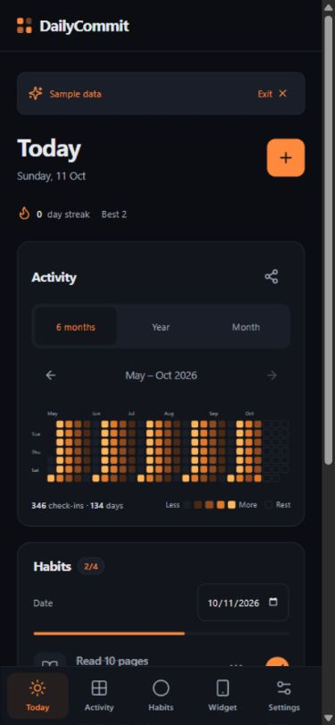

# DailyCommit

Small habits. A year of progress. A local-first React PWA with an Android companion for a real home-screen contribution widget.

[Live PWA](https://dailycommit-kailashp27.netlify.app/) · [Download testing APK](https://dailycommit-kailashp27.netlify.app/downloads/DailyCommit-0.1.1-debug.apk) · [Deployment notes](docs/DEPLOYMENT.md)



## Run

Requires Node 22.12+ or Node 24+.

```sh
npm install
npm run dev
npm test
npm run build
```

Open the URL printed by Vite. For a phone, deploy to HTTPS (Netlify configuration is included). To develop over your LAN, use `npm run dev -- --host 0.0.0.0`; HTTP on a phone is not sufficient for service-worker installation.

## Foundation implemented

- Compact mobile UI with bottom navigation: Today, Activity, Habits and Settings; widget setup lives in Settings.
- Binary and numeric habits, daily/weekday/weekly-quota schedules, date-effective schedule and target revisions.
- Completion toggles, undo, explicit skips, historical day editing, habit ordering and archival.
- Contribution graph with six-month/year views, touch-friendly month selection, per-habit graphs and PNG share/export.
- Day notes and mood, streak grace, Android reminders and explicitly limited open-app web reminders.
- A compact 42-badge collection with permanent one-time awards, rarity frames, pixel icons, star animations, secret badges, earning dates and share-image stamps. Advanced badges stay secret until earned; unsupported timer, negative-habit and stack badges are hidden.
- Group management with rename, reorder, removal with member reassignment and Undo; ten editable habit templates.
- Per-habit reminders, date-range vacations with history preservation, and optional checklists available when editing existing habits.
- Compact Today tasks; Activity ends with Badges and Weekly review. Special dates and the unlocked Ember glow live in Settings.
- Ember plus permanently unlockable Cyan (50 active days) and Neon Green (100 active days), each in dark/light mode, local rollover and week-start settings; offline device fonts.
- IndexedDB schema 4 with live cross-tab updates; v4 JSON export, v1/v2/v3/v4 import and atomic restore.
- PWA manifest, offline app-shell caching, installation help and update prompt.
- Capacitor Android project and contribution widget with 3/6/12-month ranges, projected background date refresh, reboot/timezone handling and launcher pin request.
- Explicit sample preview; no fabricated history in the actual database.

## Android is a first-release priority

A browser-installed PWA provides an app icon. Android home-screen widgets require native components, so the same web UI is bundled into an Android app using Capacitor. See [Android setup](docs/ANDROID.md). Browser and Android WebView storage are separate; use export/import to transfer history. There is no cloud sync.

## Architecture

`domain.ts` computes schedules, totals and ratios from facts. `repository.ts` owns IndexedDB and backup validation. Screens call the repository instead of the database. `widget.ts` creates a versioned display snapshot and publishes it through a native bridge. The widget keeps only that derived snapshot, never a second editable habit database.

Habit schedules are effective from the day of an edit; old revisions remain intact. Weekly-quota habits are eligible on each day until the quota has been reached earlier in that week. Completed days remain eligible. Retroactively editing an earlier completion can change eligibility on later dates in that week. Skipped habits are excluded from the denominator. Rest and missed days use distinct colors. Archiving takes effect on the selected local today; preceding history remains intact.

## Status and next work

This is a development foundation, not a released v1. The PWA and Android debug APK compile successfully in GitHub Actions. Real-phone installation, widget lifecycle checks, Lighthouse and longer-term durability checks remain pending. The project owner will perform manual phone/widget checks. See [task backlog](docs/TASKS.md) and [architecture decisions](docs/ARCHITECTURE.md).

The remaining planned app features are implemented. GitHub workflows build the web app and debug APK, and issue templates are ready. Automated checks and the production PWA build pass locally. GitHub Actions runs the checks and builds the web app and an installable debug APK, including Android lint and JVM checks. Phone/widget validation is performed manually by the project owner. The PWA is deployed to Netlify; signed production Android distribution remains separate.

The action-plan document supplied as reference has not been changed. The user's explicit widget priority overrides its “later” placement. Repository: https://github.com/kailashp-27/DailyCommit. The build workflow does not deploy; the initial Netlify publication used a manual verified-build upload.

## Download an APK for manual checks

Open the repository **Actions → Build**, select a successful run, and download **android-debug-apk** from Artifacts. Unzip it and install the APK on your Android phone. This is a debug build for manual evaluation, not a signed production release. The **web-app** artifact contains the PWA build for a later hosting step. Browser and APK data are separate; export/import a backup to move your habits.

See [manual Android checks](docs/ANDROID.md#manual-phone-checklist) for widget and reminder checks. A GitHub push builds artifacts only; it does not deploy to Netlify or publish to Google Play.
